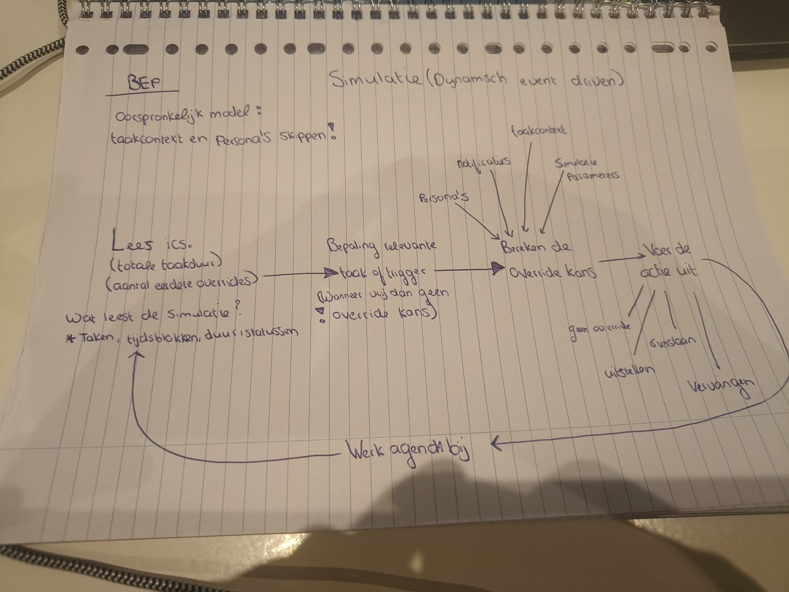
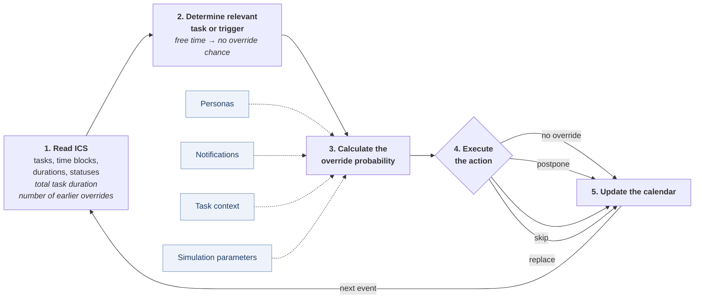

# Conceptual Model: Dynamic Event-Driven Override Simulation

This document describes the target design of the simulation. It is a digital version of the hand-drawn sketch below. For what the code does **today**, see the [manual](../MANUAL.md).

<details>
<summary>Original sketch</summary>



</details>

---

## 1. Overview

The simulation is **dynamic and event-driven**. It walks through the planned calendar one event at a time. For each relevant task or trigger it calculates the chance that the user overrides the plan, picks an action, updates the calendar, and reads the updated calendar again for the next event. This loop repeats until the end of the simulation horizon.



Dashed arrows are inputs to the probability calculation. In the **first version** of the model, the *task context* and *persona* inputs are left out (see section 4).

---

## 2. Steps of the loop

### Step 1: Read the ICS calendar

The simulation reads the current state of the calendar:

- **Tasks** (events)
- **Time blocks** (start and end)
- **Durations**
- **Statuses**

From this it keeps two state variables that feed into the override probability:

- **Total task duration**: how full the plan is.
- **Number of earlier overrides**: how often the plan has already been changed during this run.

After every update (step 5) the calendar is read again, so later decisions always see the *executed* plan rather than the original one.

### Step 2: Determine the relevant task or trigger

The simulation picks the next task or trigger to handle. When there is **no task scheduled (free time)**, there is **no override chance**, so the simulation moves on without generating an override.

### Step 3: Calculate the override probability

For the relevant task, the simulation calculates the probability of an override. Inputs:

| Input | Role | In first version? |
|---|---|---|
| Simulation parameters | Base rates and model settings | Yes |
| Notifications | Effect of reminders on execution | Yes |
| Task context | Properties of the task itself | No (skipped) |
| Personas | User type (e.g. diligent, anxious, active) | No (skipped) |

The state variables from step 1 (total task duration, number of earlier overrides) are also used here.

### Step 4: Execute the action

Based on the probability, one of four outcomes is drawn:

| Action | Effect on the plan |
|---|---|
| **No override** | The task is executed as planned. |
| **Postpone** (*uitstellen*) | The task is moved to a later time. |
| **Skip** (*overslaan*) | The task is not executed and removed from the plan. |
| **Replace** (*vervangen*) | The task is replaced by a different activity. |

### Step 5: Update the calendar

The chosen action is applied to the calendar. The updated calendar becomes the input for the next iteration (back to step 1).

---

## 3. Pseudocode

```text
calendar ← read_ics(file)
overrides ← 0

for each event / trigger in time order:
    state ← (tasks, time blocks, durations, statuses,
             total task duration, overrides)

    task ← relevant_task(event, calendar)
    if task is None:                       # free time
        continue                           # no override chance

    p ← override_probability(task, state,
                             notifications, simulation_parameters)
                             # + task_context, persona in later versions

    action ← draw from {no override, postpone, skip, replace} using p
    calendar ← apply(action, task, calendar)
    if action ≠ no override:
        overrides ← overrides + 1

write executed calendar
```

---

## 4. Scope of the first version

The sketch notes: **"Original model: skip task context and personas!"**

Version 1 therefore calculates the override probability only from:

- simulation parameters (a parameter set per persona, D15),
- notifications (a random share q of tasks, D10),
- the calendar state: planned hours left in the day (D6) and the number of earlier overrides that day (D5).

Task context (the `[ctx:...]` annotations) and persona characteristics are added as inputs in version 2. The context annotations are already loaded and kept apart (D11).

---

## 5. Mapping to the code (version 1)

| Model step | Code | Status |
|---|---|---|
| 1. Read ICS | `load_calendar()` in `src/simulation.py`; tasks and context split | Done |
| 2. Relevant task or trigger | `generate_arrivals()` (Poisson, D1) and the active-task rules in `run_replication()` (D2, D9), `src/override_simulation.py` | Done |
| 3. Override probability | `action_probabilities()` in `src/override_model.py`: multinomial logit (D3–D6, D10) | Done |
| 4. Execute action | `run_replication()`: postpone, skip, replace on the remaining part of the task (D7, D8) | Done |
| 5. Update calendar / loop | `ExecutedCalendar` in `src/override_simulation.py`; every arrival sees the executed calendar | Done |
| Output | KPIs and confidence intervals (D13, D14), executed `.ics` and change list (D12) | Done |

---

## 6. Answers to the earlier open questions

| Question | Answer in version 1 |
|---|---|
| **Trigger definition** | Poisson arrivals (D1). An arrival acts on the active task; arrivals in free time and during sleep are ignored (D2). |
| **Probability per action** | One multinomial logit over {no override, postpone, skip, replace} (D3), logistic with a rule-based part (D4). |
| **Postpone and replace rules** | Postpone: next free slot on the same day that respects the temporal rules, otherwise skip (D7). Replace: a generic `UNPLANNED` block of the same length (D8). |
| **Earlier overrides** | They **lower** the next override probability (negative coefficient), counted over the same day and capped at 3 (D5). |

The full list of decisions is in [REPORT.md](REPORT.md), section 4. How the code implements them is in the [manual](../MANUAL.md).
