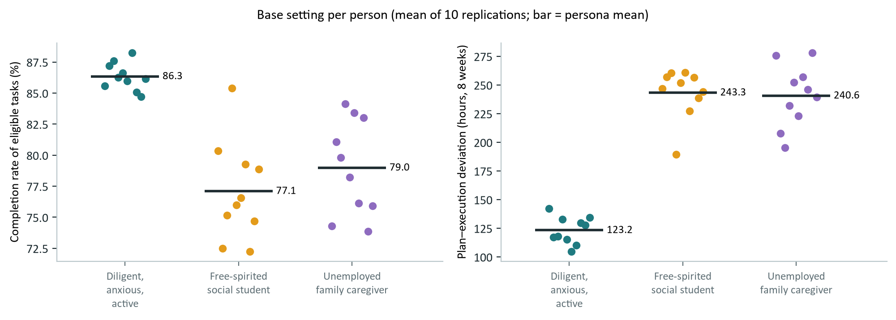
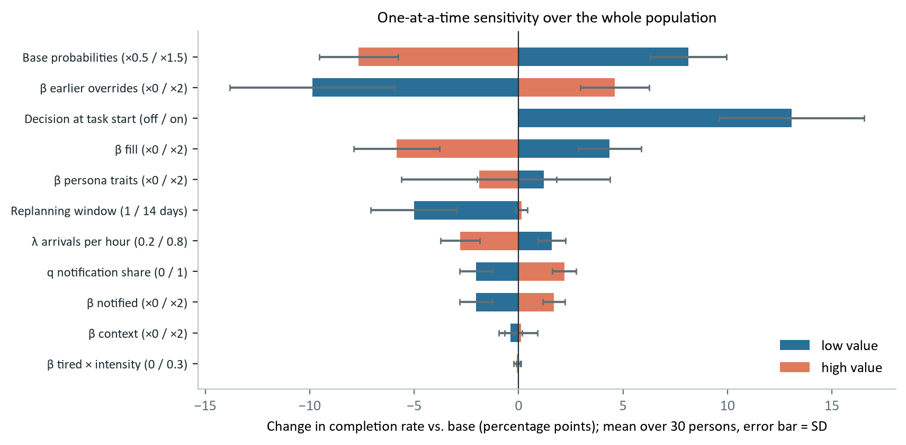
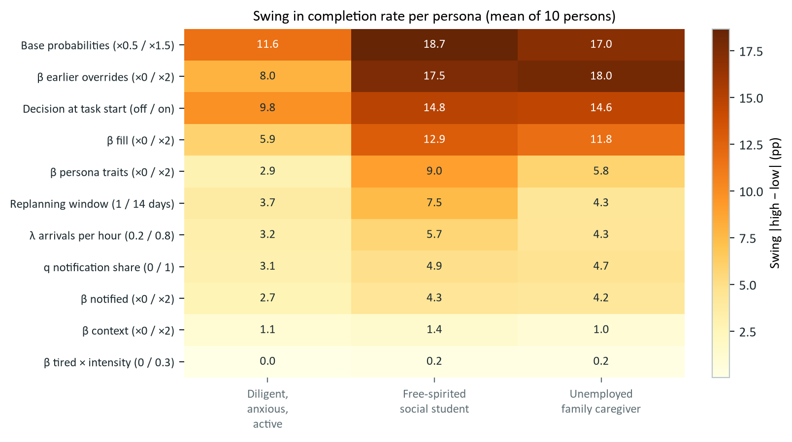
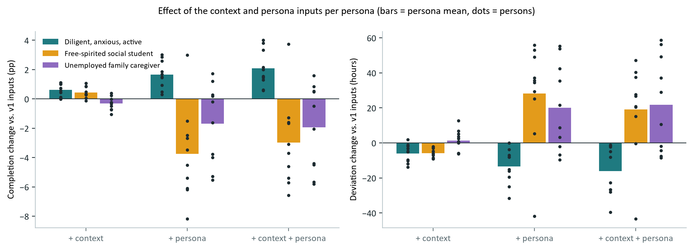
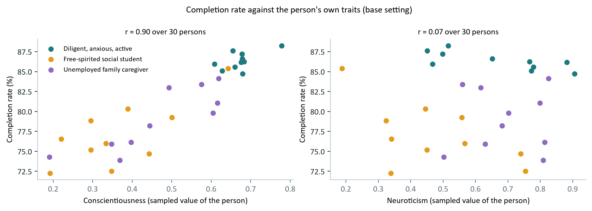

# Sensitivity analysis over the 30 calendar-bench calendars (version 2)

Version 2 of the override simulation, run on every planned calendar of the calendar-bench experiment `healthy_lifestyle_promotion`: 30 persons, 10 per persona (`calendar_bench_population/ics/`).

## Method

- **Model:** version 2 (`v2/config/v2_config.yaml`), unchanged. There is a decision at every task start plus Poisson interruptions, context covariates, persona traits, week-long replanning and context-dependent replacements.
- **Persona traits:** each person's **own sampled Big Five** from `calendar_bench_population/persons/<person>.json`, instead of the persona means that v2 uses by default.
- **Settings per person** (27 in total):
  - **base:** the config values;
  - **one-at-a-time (OAT):** each of 11 parameter groups set to a low and a high value, the rest at base (the same ranges as `v2/src/sensitivity.py`);
  - **ablation:** the context and persona inputs switched off and on.
- **Replications:** 10 per setting (seeds 42–51), the same seeds in every setting (common random numbers). Each value in the tables is the mean of those 10 replications.
- **Main KPI:** the completion rate of the eligible tasks; the plan–execution deviation (hours over 8 weeks) as a second KPI.

To reproduce (about 3 minutes with 12 parallel processes):

```bash
python v2/src/sensitivity_population.py --replications 10 --workers 12
```

## Files

| File | Contents |
|---|---|
| `results_per_person.csv` | One row per person × setting: traits, KPIs |
| `summary.xlsx` | Base KPIs per person, OAT per persona, ablation per persona, the top 3 parameters per person |
| `fig1`–`fig5` | Charts below |

## 1. The persona matters more than the person



| Persona | Completion | Deviation (h) | Postponed | Skipped | Replaced | Postponements to a later day | Mean conscientiousness |
|---|---|---|---|---|---|---|---|
| Diligent, anxious, active | **86.3%** | 123 | 10.9% | 8.6% | 5.2% | 40% | 0.67 |
| Free-spirited social student | **77.1%** | 243 | 13.4% | 15.9% | 7.1% | 76% | 0.37 |
| Unemployed family caregiver | **79.0%** | 241 | 11.6% | 16.4% | 4.7% | 54% | 0.47 |

Over all 30 persons, completion ranges from 72.2% to 88.2% (mean 80.8%).

- The diligent persona completes about 8 percentage points more tasks than the other two, and its executed calendar deviates **half as much** from the plan.
- Students and caregivers skip almost twice as often.
- Students push most of their postponements to a later day (76%), because their days have little free time left for a same-day slot.

## 2. Which parameters matter, and is that the same for everyone?





- **The same three parameters dominate for every person:** the base probabilities, β earlier overrides and the decision at the task start are in the **top 3 of 27–30 persons out of 30**. The base probabilities are the most influential parameter for 21 persons, β earlier overrides for the other 9.
- **The ranking is stable, but the size is not.** Every swing is 1.5–2.5 times larger for the student and the caregiver than for the diligent persona; for example, β earlier overrides swings 17.5–18.0 pp against 8.0 pp. When a person overrides more often, every parameter that drives overrides has more room to act. Conclusions about which parameter matters most therefore carry over between personas, but statements about how much do not.
- **The direction is consistent** for 9 of the 11 parameters: their low and high values move completion the same way for all 30 persons.
- **The exceptions are the persona-trait and context coefficients.** Scaling them up raises completion for some persons and lowers it for others (14 of 30, and 17 of 30). Traits enter the model as (trait − 0.5), so a stronger trait effect helps conscientious persons and hurts the others.
- **The context coefficients (×0 / ×2) change completion by only 1–1.4 pp on average,** and the tired × intensity term by at most 0.2 pp. Their positive and negative terms largely cancel.

## 3. How strongly do context and persona make execution deviate from the plan?



Each change is measured against the version 1 inputs (no context, no persona), with the same calendar and seeds:

| Persona | + context | + persona | + context + persona |
|---|---|---|---|
| Diligent, anxious, active | +0.6 pp | +1.7 pp | **+2.1 pp**, −16 h deviation |
| Free-spirited social student | +0.4 pp | −3.8 pp | **−3.0 pp**, +19 h deviation |
| Unemployed family caregiver | −0.3 pp | −1.7 pp | **−1.9 pp**, +22 h deviation |

This answers the question from the version 1 slides for the whole population, and it **reverses the conclusion of the single-calendar analysis** (diligent_anxious_active_0000 only), where context and persona brought execution closer to the plan:

- For the **diligent** persona, context and persona make execution **follow the plan more closely**.
- For the **student and the caregiver**, they make it **deviate more**: lower completion and about 20 hours more deviation over 8 weeks.
- The difference comes almost entirely from the **persona traits.** The context effect is small for every persona.
- **Within a persona the spread is large** (the dots in the chart). For some students the persona input lowers completion by 8 pp, for one it raises it by 3 pp. That follows their sampled conscientiousness.

## 4. Traits and completion



- **Conscientiousness predicts completion almost perfectly** (r = 0.90 over 30 persons). Neuroticism does not (r = 0.07).
- **Caution: the 0.90 is largely built into the model.** Conscientiousness has the largest trait coefficient (θ = −2.0 on postponing and skipping), so the correlation **reflects the assumed coefficient**, not an empirical finding. With calibrated coefficients this relation could be much weaker.

## Limitations

- **No parameter is fitted:** the ranges are the same assumptions as in `v2/PARAMETERS.md`.
- **One-at-a-time only:** interactions between parameters are not captured, although the larger swings for the student and caregiver suggest they exist. A global method (Morris or Sobol) is the next step.
- **Only the person's Big Five** is taken from the person file. Age, gender, occupation and weekly workouts are not model inputs.
- **10 replications per setting:** the persona means are stable, but single-person OAT values contain some simulation noise (common random numbers reduce this, but don't remove it).
