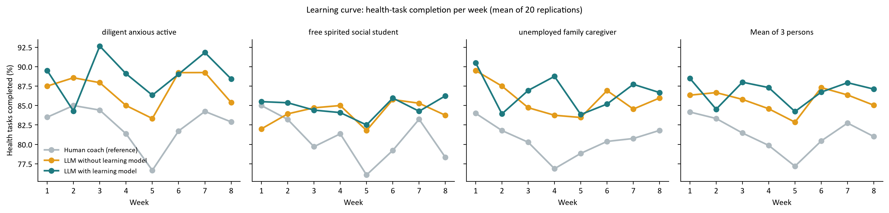
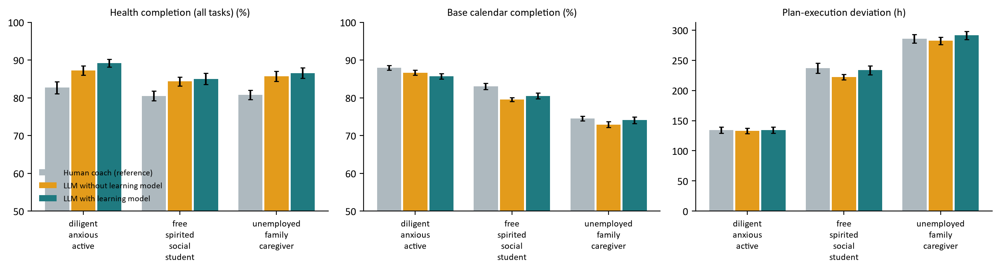
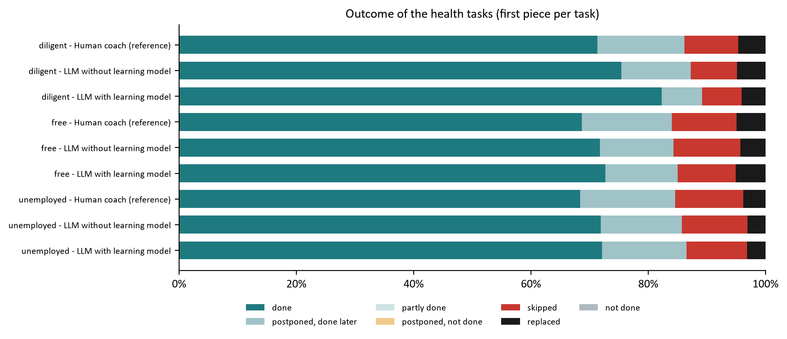

# Test: LLM planner with and without a learning model

Can an LLM that plans the health tasks of the CalendarBench coach do better when it learns from the **executed** calendar? This folder holds the test that compares:

- an LLM planner **without** a learning model;
- the same LLM planner **with** a learning model;
- the human-coach schedule from CalendarBench, as a reference.

All three are executed with simulation version 2.

Code: `v2/llm_planner/llm_planner_test.py`

## Set-up

| | |
|---|---|
| Persons | `diligent_anxious_active_0000`, `free_spirited_social_student_0000`, `unemployed_family_caregiver_0000` (one per persona) |
| Horizon | 8 weeks; per week the same health tasks the human coach got (CalendarBench solution) |
| Planner | Claude (Sonnet), one fresh instance per person per week. Each instance reads **only** its prompt file (`runs/<person>/<variant>/week_<w>_prompt.md`) and writes a JSON plan. It sees no code, no model parameters and no other files. |
| Execution | Simulation v2 (context, persona, task-start decision, week-long replanning) with the person's own Big Five traits |
| Evaluation | 20 replications (seeds 42–61), the same seeds for every planner (common random numbers). A second run uses seeds 1000–1019, which the learning model never saw (`heldout_seeds/`). |

### Prompt design (`SYSTEM` in the code)

Each prompt has the same blocks:

1. **Role and goal:** place this week's tasks so that the person *actually carries them out*, not just so that they fit.
2. **Hard rules:**
   - 10-minute grid, between 06:00 and 22:00;
   - standalone tasks only inside free windows;
   - "alongside" tasks may overlap other activities;
   - every task exactly once.
3. **Person profile** from CalendarBench: age, occupation, workouts per week. The Big Five is **not** shown.
4. **Per day:**
   - the free windows;
   - the planned busy hours;
   - the **observed** context. These are only the CalendarBench categories a planner could know: weather/environment, behaviour state, capability/opportunity, goal intention and SDT regulation. Energy, mood, stress and location stay hidden; the simulation does use them.
5. **Task table:** id, task, duration, intensity (1–3), domain, standalone/alongside.
6. **Output:** JSON `{"placements": [{"task", "date", "start"}], "lessons": "..."}`.

### The learning model

The variant **with** a learning model gets an extra block in its prompt from week 2 on. It is built from the executed calendar of the previous weeks (simulation with seed 42):

- **Feedback:** for every task of last week, when it was planned, how busy that day was, the observed context, and what happened (done, postponed and done later, replaced by X, skipped, ...).
- **Memory:** the completion rate of all earlier placements, split by:
  - time of day;
  - weekday or weekend;
  - day load;
  - intensity;
  - observed context.
- **Lessons:** the planner's own conclusions from last week (the `lessons` field), which it updates every week.

The variant **without** a learning model gets the same prompt without this block. Week 1 is planned once and used by both variants.

The planner is sequential (week *w* needs the executed weeks 1 to *w*−1), so the learning variant ran week by week.

### Plan check

Every placement is checked against the rules. A placement that breaks a rule, for example a standalone task that sticks out of its free window, is moved to the nearest valid slot ("repaired"). The share of placements that were valid without repair is a KPI.

## KPIs

| KPI | Meaning |
|---|---|
| Health completion | Share of the coach's health tasks that were fully carried out, including after a postponement |
| Health completion weeks 2–8 | The same, without the shared week 1 |
| Base calendar completion | Completion of the person's own calendar activities (does the plan push out other activities?) |
| Plan–execution deviation | Hours over 8 weeks in which the executed calendar differs from the plan |
| Placements valid | Share of LLM placements that met all rules without repair |
| Completion per week | Learning curve |

## Results (20 replications, seeds 42–61)

| Person | Planner | Health completion | Base calendar completion | Deviation (h) | Placements valid |
|---|---|---|---|---|---|
| Diligent | Human coach | 82.7% | 87.9% | 134 | – |
| | LLM without learning | 87.2% | 86.7% | 133 | 94.5% |
| | LLM with learning | **89.2%** | 85.7% | 134 | 90.9% |
| Student | Human coach | 80.5% | 83.0% | 237 | – |
| | LLM without learning | 84.3% | 79.5% | 222 | 99.4% |
| | LLM with learning | **85.0%** | 80.5% | 234 | 94.4% |
| Caregiver | Human coach | 80.8% | 74.5% | 286 | – |
| | LLM without learning | 85.7% | 72.9% | 282 | 93.0% |
| | LLM with learning | **86.6%** | 74.1% | 291 | 90.5% |

**Paired difference, LLM with learning minus LLM without learning** (same seeds, 95% CI):

| Person | Seeds 42–61 | Held-out seeds 1000–1019 |
|---|---|---|
| Diligent | **+2.0 pp** (+0.4 to +3.5) | **+2.0 pp** (+0.6 to +3.3) |
| Student | +0.7 pp (−1.4 to +2.8) | +0.9 pp (−0.9 to +2.7) |
| Caregiver | +0.8 pp (−1.1 to +2.8) | **+2.8 pp** (+1.3 to +4.2) |
| Mean of 3 | **+1.2 pp** (+0.0 to +2.3) | **+1.9 pp** (+1.0 to +2.7) |







## Findings

1. **An LLM planner already beats the human-coach schedule**, without any learning: +4.4 pp health completion on average (95% CI +3.4 to +5.4, better in 20 of 20 replications). The cost is about 2 pp lower completion of the person's own calendar activities (95% CI −2.6 to −1.6 pp); a likely cause is that the health tasks take free slots that the simulation would otherwise use to replan those activities.
2. **The learning model adds a small but consistent gain:** +1.2 pp (seeds 42–61) to +1.9 pp (held-out seeds) on top of the static LLM. That is about 87% health completion against 85–86%. It is clear for the diligent person in both seed sets; for the student it is within the noise.
3. **The planner learns sensible, person-specific rules.** Its final lessons:
   - **diligent:** "evenings 17:30–19:00, cardio spread over separate days";
   - **student:** "weekday lunch and weekend mornings, intensity 3 only on weekends";
   - **caregiver:** "light tasks, demanding tasks at midday".

   These match the drivers in the simulation (day load, intensity, habitual time), although the planner never saw the model.
4. **The learning curve is not smooth.** Week 2, with only one week of feedback, is lower than without learning for the diligent person and the caregiver: the planner over-reacts to a single week of outcomes. From week 3 on, the learning variant is at or above the static variant in most weeks.
5. **More completion, not a better fit to the plan.** The learning variant raises the plan–execution deviation by about 7–11 hours over 8 weeks compared with the static LLM. It concentrates tasks in the windows where they are carried out, which gives more postponements and changes to the other activities around them.
6. **The longer prompt costs rule-following:** with the feedback block, 90–94% of placements were valid against 93–99% without it. All invalid placements could be repaired automatically.

## Limitations

- **The planner learns the simulator, not a person.** The feedback comes from the same model that scores the plan. The gains show that the learning loop works; they are not evidence that a real person would follow the plan better. The held-out seeds only rule out that the planner learned one random sequence.
- **One person per persona** and one LLM run per week. A second LLM run would give a different plan; the variance between LLM runs is not measured.
- **Week 1 is not identical** in the results of both variants, although the plan is the same. Postponed week-1 tasks are replanned into week 2, where the two plans differ.
- **The completion measure counts a task as done** only if all its pieces are done. Partial credit is not given.

## Reproduce

```bash
# make a prompt (an LLM must then write the plan file it names)
python v2/llm_planner/llm_planner_test.py prompt --person diligent_anxious_active_0000 --variant learning --week 3
# check a written plan
python v2/llm_planner/llm_planner_test.py check --person diligent_anxious_active_0000 --variant learning --week 3
# evaluate all plans
python v2/llm_planner/llm_planner_test.py evaluate --replications 20
python v2/llm_planner/llm_planner_test.py evaluate --replications 20 --seed0 1000 --out docs/test_llm_planner/heldout_seeds
```

## Files

| File | Contents |
|---|---|
| `runs/<person>/shared/` | Week 1 prompt and plan (both variants) |
| `runs/<person>/static/` | Prompts and plans of weeks 2–8 without learning |
| `runs/<person>/learning/` | Prompts (with feedback) and plans of weeks 2–8 with learning |
| `kpis.csv`, `kpis.xlsx` | KPIs per person and planner, plus the placement log |
| `paired_differences.csv` | Paired differences between the planners |
| `heldout_seeds/` | The same evaluation on seeds 1000–1019 |
| `fig1`–`fig3` | Charts |
